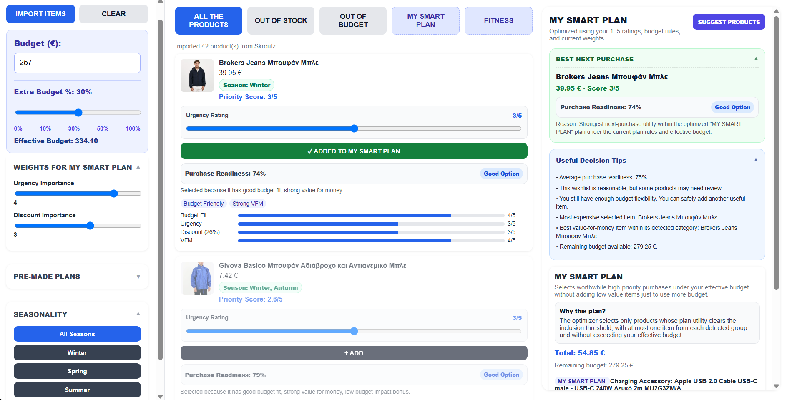

# Supporting Online Purchase Decisions

A Chrome Extension for importing Skroutz wishlist products and supporting budget-aware purchase prioritization through deterministic scoring, purchase planning, and explainable decision-support features.

## Overview

Supporting Online Purchase Decisions is a Manifest V3 Chrome Extension designed to help users evaluate and prioritize products saved in their Skroutz wishlist.

The application imports wishlist products directly from an open Skroutz Favorites page and evaluates them using deterministic, rule-based decision-support logic.

The system does not use artificial intelligence or machine learning. Product recommendations, prioritization, budget evaluation, seasonality classification, and purchase-plan generation are based on explicit scoring rules and user-defined preferences.

The application operates locally without requiring a backend server or external database.



## Features

- Import products from a Skroutz Favorites page
- Automatic product price extraction and normalization
- Explicit out-of-stock detection
- Discount detection from percentages, previous prices, and monetary coupon values
- User-defined urgency ratings on a 1–5 scale
- Configurable urgency and discount importance weights
- Base budget and optional extra-budget allowance
- Effective-budget calculation
- Out-of-budget classification
- Seasonality filtering
- Deterministic product-category detection
- Value-for-money estimation within detected product groups
- Purchase Readiness percentage and labels
- Best Next Purchase recommendation
- Budget-constrained purchase-plan optimization
- My Smart Plan, Budget, Premium, and Deal Hunter purchase strategies
- Custom saved product lists
- Wishlist-based product suggestions
- Generic complementary product suggestions
- Duplicate prevention during product re-import
- Preservation of user-defined ratings and list assignments
- Persistent local user preferences and lists
- Explainable score breakdowns and budget-impact warnings

Additional application screenshots:

- [Product Scoring](docs/screenshots/02-product-scoring.png)
- [Smart Plan](docs/screenshots/03-smart-plan.png)
- [Budget Analysis](docs/screenshots/04-budget-analysis.png)
- [Product Suggestions](docs/screenshots/05-product-suggestion.png)

More detailed screenshots are available in [`docs/screenshots/detailed/`](docs/screenshots/detailed/).

## How It Works

The extension follows four main stages:

1. **Product extraction**  
   A content script inspects the open Skroutz Favorites page, identifies valid product cards, and rejects unrelated page elements.

2. **Data normalization**  
   Product titles, URLs, prices, availability information, images, and raw card text are extracted and normalized before being merged with locally stored products.

3. **Decision scoring**  
   Products are evaluated using urgency, detected discount, budget fit, value for money, and budget-impact rules. Additional indicators provide information about purchase readiness and product relevance.

4. **Purchase planning**  
   Products tracked by the user can be processed by a budget-constrained optimizer that selects worthwhile combinations without exceeding the effective budget.

The entire decision-support process is performed locally within the Chrome Extension.

## Architecture

The application consists of two main JavaScript execution contexts:

- `src/wishlistScraper.js` — runs as a content script on supported Skroutz pages and extracts product information from the DOM.
- `src/decisionLogic.js` — manages storage, scoring, budgeting, purchase-plan generation, filtering, suggestions, and application state.

The interface is implemented with:

- `src/dashboard.html`
- `src/dashboard.css`

The extension configuration is defined in:

- `src/manifest.json`

The extension uses a popup launcher that opens the main application in a dedicated browser tab.

The content script communicates with the extension application through Chrome message passing.

Imported product information is processed locally and stored through `chrome.storage.local`.

Detailed architecture documentation is available in [`docs/architecture/`](docs/architecture/).

## Scoring Model

The application uses a deterministic 1–5 rating system.

The user controls two primary preference weights:

- **Urgency Importance**
- **Discount Importance**

Each weight can be adjusted from 0 to 5.

The weighted preference score is calculated as:

```text
Weighted Preference Score =
(Urgency Rating × Urgency Weight +
 Discount Rating × Discount Weight)
/
(Urgency Weight + Discount Weight)
```

Only positive weights participate in the weighted average. When both weights are zero, a neutral fallback score is used.

A budget-impact adjustment is then applied to produce the final Priority Score, constrained to the 1–5 scale.

Additional metrics such as Budget Fit and Value for Money are shown separately to improve explainability and are also used by specific purchase-plan strategies.

Purchase Readiness is calculated independently as a percentage-based indicator incorporating priority, budget compatibility, value for money, seasonality, and availability.

See [`docs/architecture/scoring-engine.md`](docs/architecture/scoring-engine.md) for details.

## Budget Model

Users define:

- a base budget;
- an optional Extra Budget percentage.

Available Extra Budget options are:

```text
0%, 10%, 30%, 50%, 100%
```

The effective budget is:

```text
Effective Budget =
Base Budget × (1 + Extra Budget / 100)
```

The effective budget acts as a hard constraint during purchase-plan optimization.

Products exceeding the effective budget are classified accordingly and excluded from budget-constrained purchase plans.

Monetary comparisons are performed using integer cents to reduce floating-point boundary errors.

The application distinguishes between an unset budget and a budget explicitly set to zero.

## Purchase Plans

The extension provides:

### My Smart Plan

Uses the current user-defined urgency and discount weights.

Purchase-plan optimization primarily considers the resulting Priority Score while respecting the effective budget.

### Budget Plan

Prioritizes budget fit, product priority, and value for money.

The strategy favors products that provide stronger compatibility with the available budget.

### Premium Plan

Favors relatively higher-priced products inside each detected product group while still respecting the available budget.

The relative price rating is a deterministic heuristic and does not represent a direct measurement of product quality.

### Deal Hunter Plan

Prioritizes detected discount strength and product priority.

This strategy gives greater importance to products with stronger identified discounts.

The predefined strategies also apply corresponding urgency and discount preference weights.

The optimizer respects the effective-budget constraint and avoids adding low-value products only to consume unused budget.

It also prevents the selection of multiple products from the same detected product group within a generated plan.

## Installation

This project is currently installed as an unpacked Chrome Extension.

1. Clone the repository:

```bash
git clone https://github.com/ChristosGkovaris/Supporting-Online-Purchase-Decisions.git
```

2. Open Chrome and navigate to:

```text
chrome://extensions
```

3. Enable **Developer mode**.

4. Select **Load unpacked**.

5. Select the repository's:

```text
src/
```

directory, which contains `manifest.json`.

6. Open a Skroutz Favorites page while signed in to your Skroutz account.

7. Open the extension and select **OPEN APP**.

8. Select **IMPORT ITEMS** to import products from the open Favorites page.

The application opens in a dedicated browser tab.

No backend configuration, external database, or npm dependency installation is required to run the Chrome Extension.

## Usage

1. Open your Skroutz Favorites page.
2. Launch the extension through **OPEN APP**.
3. Import wishlist items using **IMPORT ITEMS**.
4. Enter a base budget.
5. Optionally select an Extra Budget percentage.
6. Adjust urgency ratings for individual products.
7. Configure urgency and discount importance.
8. Review Priority Score, Budget Fit, Value for Money, and Purchase Readiness.
9. Add products to `MY SMART PLAN` or another custom list.
10. Select a purchase strategy and review the generated purchase plan.
11. Inspect the selected products, total cost, and remaining budget.
12. Use seasonality, out-of-stock, and out-of-budget views when needed.

The application also provides explanatory decision indicators, wishlist-based suggestions, and generic complementary product ideas.

User-defined urgency ratings, tracked states, and list assignments are preserved during subsequent product imports when matching products are identified.

## Data Storage

Application state is stored locally through the Chrome Storage API.

Stored data includes:

- imported product information;
- product URLs, prices, and availability information;
- urgency ratings;
- tracked product states;
- scoring weights;
- budget configuration;
- Extra Budget configuration;
- user-created lists;
- product-list assignments;
- saved generic product ideas.

The application uses `chrome.storage.local` to preserve relevant state between browser sessions.

The current implementation does not require a backend server or external database.

Imported wishlist data and user preferences are not transmitted to an application-controlled backend.

## Privacy

The extension requires access to supported Skroutz pages so that the content script can inspect the currently loaded Favorites page.

Product and preference data are processed locally by the extension.

The application does not require user registration, banking information, or payment credentials.

The extension requests the following Chrome permissions:

```text
storage
tabs
scripting
```

Host permissions are limited to the declared Skroutz HTTPS domains.

The application does not implement additional encryption for its locally stored data.

See [`docs/architecture/privacy-and-security.md`](docs/architecture/privacy-and-security.md).

## Testing

The application has been validated through automated tests and manual browser-level regression testing.

The automated test suite uses Python's built-in `unittest` framework and a Node.js test harness to execute the application's JavaScript logic using mocked browser interfaces.

For the supplied repository version, the automated suite contains **45 tests**, all of which passed.

Automated coverage includes:

- extension configuration;
- product extraction and DOM validation;
- price parsing;
- explicit out-of-stock detection;
- discount detection;
- budget boundaries;
- zero, negative, and unset budgets;
- Extra Budget calculations;
- integer-cent monetary comparisons;
- scoring behavior;
- product grouping and seasonality;
- Purchase Readiness;
- optimizer constraints;
- product identity and duplicate prevention;
- product re-import and user-state preservation;
- recommendation selection;
- selected static code-quality checks.

Run the automated test suite from the repository root:

```bash
python scripts/run_tests.py
```

Requirements:

- Python 3.10+
- Node.js 18+ recommended

Manual browser-level validation additionally covers:

- live Skroutz Favorites product import;
- rejection of unrelated DOM elements;
- imported product-count verification;
- out-of-stock classification;
- exact-budget behavior;
- Extra Budget behavior;
- urgency and weight sensitivity;
- purchase-plan budget compliance;
- state persistence after reload.

The automated tests validate deterministic logic through mocked browser APIs and do not replace live Chrome Extension testing.

The repository also includes a GitHub Actions workflow that runs the automated suite on pushes and pull requests targeting `main`.

See:

- [`tests/README.md`](tests/README.md)


## Project Structure

```text
Supporting-Online-Purchase-Decisions/
│
├── .github/
│   └── workflows/
│       └── tests.yml
│
├── docs/
│   ├── architecture/
│   │   ├── data-flow.md
│   │   ├── privacy-and-security.md
│   │   ├── scoring-engine.md
│   │   └── system-overview.md
│   │
│   ├── presentation/
│   │   └── thesis-presentation.pdf
│   │
│   ├── screenshots/
│   │   ├── detailed/
│   │   │   ├── 01-application-overview.png
│   │   │   ├── 02-product-scoring.png
│   │   │   ├── 03-smart-plan.png
│   │   │   ├── 04-budget-analysis.png
│   │   │   └── 05-product-suggestion.png
│   │   │
│   │   ├── 01-application-overview.png
│   │   ├── 02-product-scoring.png
│   │   ├── 03-smart-plan.png
│   │   ├── 04-budget-analysis.png
│   │   └── 05-product-suggestion.png
│   │
│   └── thesis-manuscript/
│       ├── project-summary.md
│       └── thesis.pdf
│
├── scripts/
│   └── run_tests.py
│
├── src/
│   ├── dashboard.css
│   ├── dashboard.html
│   ├── decisionLogic.js
│   ├── manifest.json
│   └── wishlistScraper.js
│
├── tests/
│   ├── __init__.py
│   ├── _node_harness.py
│   ├── README.md
│   ├── test_code_quality.py
│   ├── test_content_logic.py
│   ├── test_manifest.py
│   ├── test_popup_logic.py
│   └── test_regressions.py
│
├── .gitattributes
├── .gitignore
├── CHANGELOG.md
├── CITATION.cff
├── LICENSE
└── README.md
```

The `src/` directory contains the installable Chrome Extension.

The `docs/` directory contains architecture documentation, screenshots, the thesis manuscript, and presentation material.

The `scripts/` and `tests/` directories contain the automated testing infrastructure.

## Technology Stack

- JavaScript
- HTML5
- CSS3
- Chrome Extensions Manifest V3
- Chrome Storage API
- Chrome Tabs API
- Chrome Scripting API
- DOM-based data extraction
- Python `unittest` for automated testing
- Node.js for JavaScript test execution
- GitHub Actions for continuous integration

The runtime application is implemented entirely on the client side.

Python and Node.js are used for testing and are not required for normal extension operation.

## Academic Context

This repository contains the software implementation of an academic project focused on supporting online purchase decisions through explainable, deterministic decision-support techniques.

The application explores wishlist prioritization, budget-aware planning, product scoring, and consumer decision support without relying on artificial intelligence or machine learning.

The project was developed as part of a thesis in Computer Science and Engineering at the University of Ioannina, Greece.

The associated academic documentation is available in the repository:

- [Full Thesis Manuscript (PDF)](docs/thesis-manuscript/thesis.pdf)
- [Project Summary](docs/thesis-manuscript/project-summary.md)
- [Thesis Presentation (PDF)](docs/presentation/thesis-presentation.pdf)

The implementation demonstrates the practical application of deterministic decision-support methods within a browser extension.

Its functional validation is based on automated and manual testing rather than a formal user study measuring the effectiveness of purchase decisions.

Citation metadata is provided in [`CITATION.cff`](CITATION.cff).

## Limitations

- Product extraction currently supports Skroutz Favorites pages and depends on the current Skroutz DOM structure.
- Changes to Skroutz page layouts may require maintenance of extraction selectors and product-detection rules.
- Product categories and seasonality are inferred through deterministic keyword rules.
- Category detection does not guarantee complete or semantically perfect product classification.
- Value-for-money estimation is relative to other imported products in the detected group and does not directly measure product quality.
- The Premium Plan uses relative product prices rather than verified product-quality indicators.
- Generic product suggestions do not assume or fabricate live Skroutz prices.
- The application does not perform automatic background price monitoring or continuous synchronization with Skroutz.
- The application does not purchase products or submit orders on behalf of the user.
- Automated tests use mocked browser interfaces and do not reproduce the complete live Skroutz environment.
- The extension is not affiliated with, sponsored by, or endorsed by Skroutz.

## License

Copyright © 2026 Christos Gkovaris. All rights reserved.

This project is proprietary software developed as part of an academic thesis. The source code is publicly available for inspection, but copying, modification, distribution, sublicensing, or reuse requires prior written permission from the author.

See [`LICENSE`](LICENSE) for details.